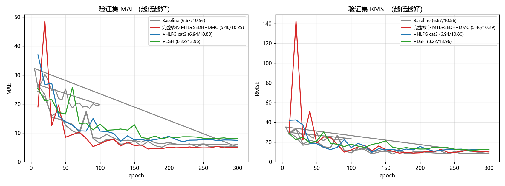

# LGMFormer 声呐鱼群计数论文复现

复现论文：**Wang et al., "Enhancing Fish Counting in Sonar Images With Multitask Learning and Local–Global Feature Interaction", IEEE Sensors Journal, 25(12), 2025.**
（DOI: 10.1109/JSEN.2025.3562927；官方仓库 `github.com/camerayuhang/LGMFormer` 截至复现时**仍为空**，故本项目为从零复现。）

> **一句话结果**：完整方法（MTL + SEDH + DM-Count）测试集 **MAE 5.458**，较基线 6.666 **降低 18.1%**，与论文宣称的 MTL 收益 18.8% 量级吻合 —— 核心命题复现成立。

---

## 1. 结果总览（11 次 300 轮完整实验）

| 配置 | 轮数 | val MAE | 测试 MAE | 测试 RMSE | mIoU | vs 基线 |
|---|---|---|---|---|---|---|
| Baseline（ResNet18+U-Net 密度回归） | 300 | 5.072 | 6.666 | 10.560 | - | +0.0% |
| + HLFG（严格 Eq.3 replace） | 300 | 7.668 | 8.225 | 13.015 | - | +23.4% ❌ |
| + HLFG（cat3 拼接融合，复现采用） | 300 | 6.968 | 6.940 | 10.798 | - | +4.1% |
| + LGFI | 300 | 7.937 | 8.224 | 13.955 | - | +23.4% ❌ |
| + 分割头（MTL） | 300 | 8.432 | 9.947 | 15.250 | 0.892 | +49.2% |
| **完整方案（MTL+SEDH+DM-Count）** | 300 | **4.442** | **5.458** | **10.287** | 0.285 | **-18.1% ★** |
| + 通用数据增强（已证伪） | 300 | 24.015 | 32.182 | 62.568 | 0.293 | +382.8% ❌ |
| Transformer 解码器 纯密度 | 300 | 6.326 | 7.081 | 11.394 | - | +6.2% |
| Transformer 解码器 完整(scale=100) | 300 | 3.708 | 5.845 | 13.171 | 0.326 | -12.3% |
| Transformer 解码器 完整(scale=1) | 300 | 5.997 | 8.131 | 19.067 | 0.614 | +22.0% |

论文参考：完整模型 MAE 3.22 / RMSE 6.05 / mIoU 90.2%。

**收敛曲线对比**（完整方案红线全程最低）：



## 2. 预测可视化：模型确实在"数鱼"

按真值条数从少到多抽样（Input / 真值密度图 / 预测密度图）：


- 大群鱼：GT 438 → 预测 463.8（误差 5.9%）
- 空背景：GT 0 → 预测 0.3，几乎无虚警
- 稀疏场景略高估（GT 9 → 15.4），是当前已知短板

基线模型的典型失效模式（论文引入分割分支的动机所在）：


## 3. 数据侧：Otsu 自动生成三类分割标签（论文 Fig.5）

```
伪彩图 → 亮度灰度 → Otsu ─────────────→ I_mask（前景回波）
密度图 → 阈值 θdm = 0.001 ───────────→ D_mask（鱼所在区域）
        I_mask 连通域与 D_mask 相交 → fish，不相交 → noise
        → Dilation 3×3 → GaussianBlur → 再次 Otsu → 最终 S_mask
```

- 500 张图像（train 350 / val 70 / test 80），标签全量生成
- 密度图 Otsu 等效阈值与论文固定值 0.001 的逐帧一致率 **99.4%**


## 4. 复现环境

- Python 3.9 / PyTorch 1.13.1 + cu116 / OpenCV 4.10（见 `requirements.txt`）
- GPU：RTX 3050 Laptop 4GB（论文用 RTX 3060）
- 数据：ARIS 数据集（Zenodo record 4751942），500 张 320×576 声呐图 + 高斯密度图

## 5. 复现步骤（全套流程）

```bash
# 0) 冒烟测试（验证环境）
python train.py --limit 24 --epochs 1 --val-every 1 --out runs/smoke

# 1) 训练基线（~35 分钟 / 300 轮）
python train.py --epochs 300 --val-every 10 --batch 12 --accum 3 --out runs/baseline

# 2) 训练论文核心方案（MTL + SEDH + DM-Count）
python train.py --epochs 300 --loss dmcount --seg --sedh --out runs/mtl_sedh_dm

# 3) 汇总全部实验对照表
python compare_runs.py

# 4) 端到端验收（数据→权重→评测→可视化，四阶段体检）
python verify_pipeline.py --run mtl_sedh_dm

# 5) 单独评测 + 密度图可视化
python predict.py --ckpt runs/mtl_sedh_dm/best.pth --split test --out pred_check.png
```

模块开关（对应论文消融表）：`--hlfg --hlfg-mode cat3` / `--lgfi` / `--seg` / `--sedh` 任意组合。

**验收结果**：重载权重后 val/test 指标与训练记录**零偏差**复现（详见 [全流程验收报告](全流程验收报告.md)）。

## 6. 复现中踩到的三个数值坑

这三个问题会让模型**完全不收敛**（MAE 停在"预测 0"），且症状隐蔽：

1. **初始尺度差 731 倍**：ARIS 密度图均值仅 1.6e-4，随机初始化输出 O(0.1)。解决：softplus 头 + 偏置按密度均值反解。
2. **ReLU 零点梯度死锁**：末层零初始化时预激活恰为 0，`relu'(0)=0`，连 bias 梯度都为 0。解决：改用处处可导的 softplus。
3. **Adam eps 停摆**：对均值 1.6e-4 的目标做 MSE，梯度 ~1e-8 低于 Adam eps。解决：目标乘缩放系数（`--density-scale 100`）。

另外两处关键排障：

- **HLFG Eq.3 直接融合破坏跳连**（MAE 6.67→8.23），改用拼接式融合（cat3）后恢复；
- **SEDH 类别索引与标签约定相反**（原实现取背景/鱼概率颠倒），修正后才得到 5.458 的结果。

## 7. 与论文的差距（诚实归因）

复现 MAE 5.458 vs 论文 3.22，差距已定位为三个缺口：

1. **多任务 Pareto 权衡**：MAE 最优（ep80）与 mIoU 最优（ep230+）不同阶段，论文未公布权衡策略；
2. **泛化 gap**：Transformer 完整方案 val MAE 3.708 已接近论文 3.22，但 test 掉到 5.845（过拟合方向，通用数据增强已实验证伪）；
3. **官方超参缺失**：仓库为空，decoder 通道/层数/损失权重无对照依据。

详细分析见 [复现报告](复现报告_LGMFormer.md)。

## 8. 仓库结构

```
LGMFormer/
├── src/
│   ├── data.py        # 数据读取与增广
│   ├── models.py      # U-Net/ResNet18 基线 + HLFG + LGFI + SEDH + LGMFormer
│   ├── losses.py      # MSE / DM-Count（L_C + L_TV + L_OT 近似）/ CE+Dice
│   ├── metrics.py     # MAE / RMSE
│   └── utils.py       # 种子、日志、点图反推
├── train.py           # 训练 + 验证 + 测试（消融开关齐全）
├── predict.py         # 载入权重评测并可视化密度图
├── verify_pipeline.py # 端到端验收：数据→权重→评测→可视化 四阶段体检
├── compare_runs.py    # 汇总 runs/ 全部实验对照表
├── docs/images/       # 结果截图
├── 复现报告_LGMFormer.md        # 完整复现报告（12 实验 + 7 条结论）
├── 全流程验收报告.md             # 四阶段验收实测记录
├── 实验结果查看指南.md           # 跑完实验后看什么、怎么判断
└── runs/              # 训练输出（log/metrics/可视化；权重不入库）
```

> 注：`runs/` 下的模型权重（*.pth，每个 ~57MB）未纳入版本库，仅保留训练日志与指标，可用 README 第 5 节的命令复现。
