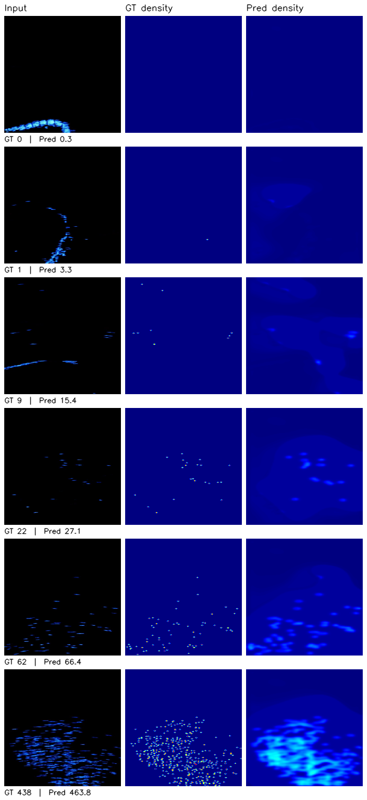
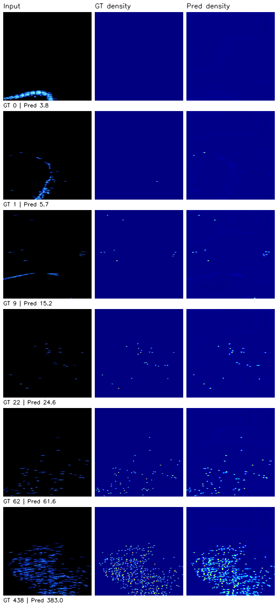
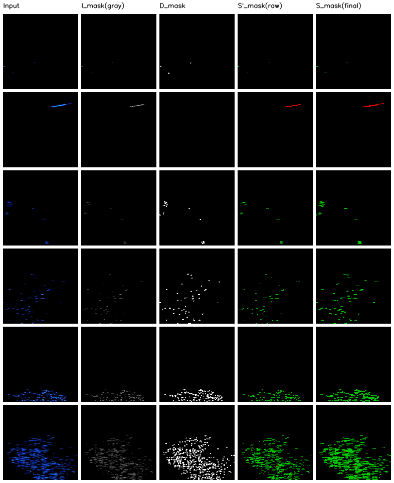

<div align="center">

# Task · 每周论文复现与阅读

**Week 1：LGMFormer 声呐鱼群计数论文复现（2026-10-14 ~ 10-16）**


-brightgreen)

</div>

---

## 本周一句话结果

复现 LGMFormer（IEEE Sensors J. 2025，声呐鱼群计数）核心方法：
**MTL + SEDH + DM-Count 测试集 MAE 5.458，较基线 6.666 降低 18.1%**，
与论文宣称的 MTL 收益 18.8% 量级吻合 —— 核心命题复现成立。
（论文官方仓库为空，全部模块按公式 Eq.1–17 与 Fig.2–5 从零实现）

## 本周目录：[Week1_LGMFormer/](Week1_LGMFormer/)

| 文件 | 说明 |
|---|---|
| `src/` + `train.py` 等脚本 | 核心代码（模型 / 损失 / 数据 / 训练 / 验收 / 汇总） |
| `requirements.txt` | 依赖库 |
| `result_loss.png` | 结果截图：11 次实验收敛曲线对比 |
| `result_vis.png` | 结果截图：真值 vs 预测密度图 |
| `result_seg.png` / `result_baseline.png` | 结果截图：分割标签自检 / 基线失效模式 |
| `docs/` | 复现报告、验收报告、结果查看指南、汇报 PPT |
| `runs/` | 全部实验的训练日志与指标（权重未入库，可按步骤复现） |

---

## 流程步骤

**1. 数据准备**：下载 ARIS 数据集（500 张 320×576 声呐图，train/val/test = 350/70/80）；
按论文 Fig.5 用 Otsu 阈值法自动生成三类分割标签（fish / noise / background），
密度图 Otsu 等效阈值与论文固定值 0.001 的逐帧一致率 **99.4%**。

**2. 搭基线**：ResNet18 编码器 + U-Net 解码器回归密度图，对密度图求和得到计数。
300 轮训练 → 测试 MAE 6.666。

**3. 逐个复现论文模块**（对应消融表）：
- **HLFG**（Eq.1–3）：高层特征生成通道注意力引导低层融合
- **LGFI**（Eq.4–6）：窗口注意力 + 十字卷积 + 多尺度空洞卷积
- **MTL**（Eq.8）：三类分割分支，CE + Dice 辅助监督
- **SEDH**（Eq.9–11）：用分割概率图增强鱼区、抑制噪声，精修密度图
- **DM-Count**：L_Count + L_TV + L_OT 分布匹配损失

**4. 完整方案训练**（MTL + SEDH + DM-Count）→ 测试 **MAE 5.458（↓18.1%）**

**5. 端到端验收**：重载权重重跑 val/test，四项指标与训练记录**零偏差**复现；
可视化确认模型确实在数鱼（大群 GT 438 → 预测 463.8，误差 5.9%）。

关键命令（在 `Week1_LGMFormer/` 内执行）：

```bash
python train.py --epochs 300 --loss dmcount --seg --sedh --out runs/mtl_sedh_dm  # 核心方案
python compare_runs.py                       # 汇总 11 次实验对照表
python verify_pipeline.py --run mtl_sedh_dm  # 端到端验收
python predict.py --ckpt runs/mtl_sedh_dm/best.pth --split test --out pred_check.png
```

## 结果截图

**11 次实验收敛曲线**（完整方案红线全程最低；完整对照表见 [Week1_LGMFormer/docs/复现报告.md](Week1_LGMFormer/docs/复现报告.md)）：


**真值 vs 预测密度图**（Input / GT / Pred，按鱼数从少到多抽样）：



**基线失效模式**（噪声被计入鱼数 —— 这正是论文引入分割分支的动机）：



**Otsu 三类分割标签自检**（论文 Fig.5 流程）：



## 论文想法

1. **技术谱系**：这篇论文的技术大半来自人群计数 —— 密度图回归范式来自 CSRNet（CVPR 2018），
   DM-Count 损失来自人群计数（NeurIPS 2020），LGMFormer 的贡献是把这些搬进声呐场景
   并加上"分割辅助计数"。详见[技术谱系笔记](papers/2026-10-15_技术谱系_人群计数到鱼群计数.md)。
2. **实验新发现**：单独加分割头计数反而变差（9.95），配上 SEDH 后才降到 5.458 ——
   "分割 + 概率精修"这个组合才是论文真正的贡献点，不是单个模块。
3. **声呐 ≠ 光学**：声呐回波强度是物理量，通用数据增强（亮度抖动、随机擦除）会灾难性破坏任务
   （MAE 32.18，已实验证伪）—— 这是与人群计数迁移时最需要注意的差异。
4. **遗留问题**：与论文 3.22 的差距定位为三个缺口（多任务权衡 / 泛化 gap / 官方超参缺失），
   详细归因见[复现报告](Week1_LGMFormer/docs/复现报告.md)。

## 与论文的差距（诚实声明）

复现 5.458 vs 论文 3.22：① MAE 最优与 mIoU 最优不在同一训练阶段（论文未公布权衡策略）；
② Transformer 方案 val 3.708 已接近 3.22 但 test 掉到 5.845（过拟合方向）；
③ 官方仓库为空，关键超参无对照依据。下周计划用 EMA / TTA 压泛化 gap。

---

## 导航

| 内容 | 链接 |
|---|---|
| 每周进度记录 | [PROGRESS.md](PROGRESS.md) |
| 论文阅读笔记 | [papers/](papers/) |
| Week1 完整报告 | [Week1_LGMFormer/docs/复现报告.md](Week1_LGMFormer/docs/复现报告.md) |
| 全流程验收报告 | [Week1_LGMFormer/docs/全流程验收报告.md](Week1_LGMFormer/docs/全流程验收报告.md) |
| 汇报 PPT | [Week1_LGMFormer/docs/presentation/](Week1_LGMFormer/docs/presentation/) |

---

<div align="center">
<sub>本仓库为课程科研复现工作，非官方实现 · 最近更新 2026-10-16</sub>
</div>
